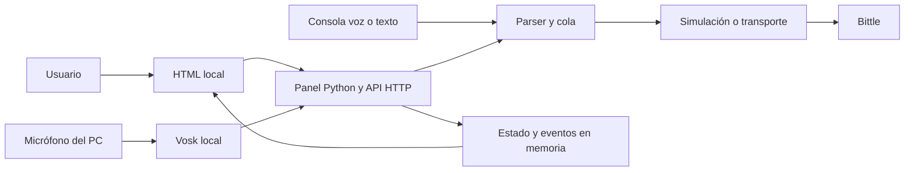

# Arquitectura implementada y plan de evolución

Versión documental 0.5 · 2026-11-12. Arquitectura y componentes de la versión final.

## Componentes y concurrencia

| Archivo/componente | Responsabilidad |
|---|---|
| `web/index.html` | HTML/CSS/JS sin dependencias web; GET estado cada 500 ms y acciones POST; botones, medidor y lista de pendientes |
| `bittle_web.Panel` | Sesión compartida por pestañas, bloqueo RLock del estado, serialización de conectar/desconectar y captura cancelable |
| `bittle_web.crear_servidor` | ThreadingHTTPServer, localhost, validación de peticiones y rutas documentadas |
| `bittle_voz.buscar_comandos` | Normalización, alias, secuencias, conectores y prioridad absoluta de parada |
| `bittle_voz.ColaAcciones` | Condition + deque, un hilo ejecutor, generación de cancelación y espera interrumpible |
| `EnlaceSerie` | pyserial, 115200 por defecto, ASCII+LF, espera de arranque, lectura informativa, sin reenvío y recuperación manual |
| `EnlaceBLE` | bleak en bucle asyncio dedicado; solo CLI, fragmentos de hasta 20 bytes |
| `EnlaceSimulado` | Imprime token, sin hardware |
| `COREOGRAFIAS` | Pasos y esperas de baile/Cristiano; puede invocar voz Windows como efecto, no como aviso general |

La cola usa generación para invalidar el resto de una acción; no puede retirar una
escritura ya iniciada. La comprobación de generación y el envío no son atómicos:
un paso ya seleccionado puede salir antes de la parada. Si falla un envío,
descarta los movimientos pendientes; si hubo PARA concurrente, conserva solo esa solicitud. El transporte serie fallido permanece bloqueado hasta crear una nueva sesión.
Estado visible en cola es actividad del hilo Python, no postura del robot.

## Captura: diferencias importantes

Panel: 16 kHz, mono PCM int16, bloques 4000, cola de audio de 8 bloques,
comprobación de cancelación antes de aceptar texto final. Error del dispositivo
se presenta y apaga escucha. Cargar modelo puede tardar; apagar invalida la sesión
sin abortar forzosamente la carga. El hilo anterior debe terminar antes de reactivar.

CLI: bloques 8000, cola de audio sin límite y callback que no procesa su estado
de error. No tiene botón de pausa de escucha ni medidor. No atribuirle los controles
del panel. Ambos usan GRAMATICA y validación textual sin umbral acústico.

## Decisiones técnicas

Python 3.12.10 constatado, dependencias declaradas en requirements-bittle.txt.
Sin base de datos ni persistencia de eventos. El HTML necesita servidor, no funciona
como archivo autónomo ni como servicio accesible desde un móvil por la red.
El código no usa PetoiRobot ni requiere instalar OpenCat como biblioteca Python;
el firmware compatible del robot sigue siendo necesario.

## Alcance final y posibles ampliaciones

La línea base es H1 v0.4. Inglés, consultas habladas, confianza y registro persistente
no se prometen en esta entrega. Podrían añadirse en otra versión. Caracterizar
rendimiento/fallos o mejorar la gestión de enlace no convierte esos resultados en
mediciones ya hechas. Ver tareas y decisiones para el alcance aprobado por el usuario.

## Contexto técnico y comprobación de principios

Plataforma: Windows, Python 3.12.10; tipo: CLI y panel local; almacenamiento: RAM.
Dependencias: requirements-bittle.txt; pruebas: pytest mediante requirements.txt.
Un operador y una sesión de transporte; varios navegadores comparten la misma sesión.
No hay objetivo acústico medido impuesto por esta revisión. Capacidad de cola, audio y
eventos se especifica en ACT-05/10/11. Principios .specify: se conserva historia, no se
opera hardware, no se publica, y se registran riesgos. Los límites físicos y asuntos académicos
se conservan en el cierre de H4 con la evidencia disponible; no se exige repetir ensayos físicos. La aceptación académica no se presume.

## Integración progresiva

| Incremento | Dependencias | Resultado verificable | Tareas |
|---|---|---|---|
| I0 Base documental y entorno | Fuentes Moodle y código recibido | H1, historias, contratos y entorno identificados | T001-T004 |
| I1 Primer incremento funcional | I0 | Dos órdenes y una no reconocida, parser más adaptador sin robot | T005, T006, T008 |
| I2 Secuencias | Parser I1 | FIFO, capacidad, cancelación, fallo y cierre | T007 |
| I3 Captura controlada | I1 | Estados y errores de audio con dobles, sin micrófono real | T009 |
| I4 Cierre software | I1, I2, I3 | Evidencias, trazabilidad, extracción, commit y ZIP | T010-T013 |
| I5 Consolidación H4 | Evidencias físicas disponibles y CR-01 | Observado, verificado por software y no comprobado claramente separados | T014-T017 |

I1 es mínimo y demostrable independientemente de la voz real. El orden expresa
dependencias técnicas y de esta revisión, no fechas históricas de desarrollo.
Pruebas por nivel: parser (tokens), controlador (cola/error), interfaz (bytes o tokens
capturados). Después se ejecuta HTTP local y consola simulada; solo tras ello procede H4.
La planificación de voz real debe distinguir transcripción correcta de rechazo de no órdenes.

## Estructura y decisiones vinculadas

Raíz: bittle_voz.py y bittle_web.py; vista: web/index.html; pruebas: tests/unit/;
documentación: docs/h1/, specs/001-voice-bittle-spec/, docs/H3/; evidencias: evidencias/actual/.
DF-01 idioma y vocabulario → ACT-03/04/09, T005/T009; DF-03 cola → ACT-05/06/07/08,
T007; transporte → ACT-02/13/15, T006/T008; panel local → ACT-01/11/14, T006;
reproducibilidad → ACT-16, T010-T013. Alternativas y fuentes en research.md.
La guía [quickstart.md](quickstart.md) define el recorrido de validación y remite a GUIA.md.

## Estrategia operativa de voz

La estrategia de uso elegida por el equipo mantiene el micrófono apagado salvo al
dictar instrucciones desde el panel. Tras aceptar una orden o secuencia, se desactiva
manualmente la escucha; la cola continúa. PARA se pulsa en pantalla cuando no se escucha.
No hay silenciamiento automático ni confirmación previa: las acciones pueden comenzar
al aceptarse. Persiste la posibilidad de transcripción errónea con escucha activa.
OPEN-03 documenta una limitación conocida con mitigación operativa, no una corrección
software pendiente. El ensayo fallido de conversación se conserva como tal.

