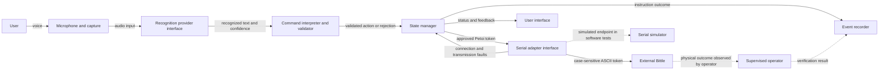

# Implementation Plan: VOICE-BITTLE Voice-Control System

**Branch**: `001-voice-bittle-spec` | **Date**: 2026-10-26 | **Spec**: [spec.md](./spec.md)

**Input**: H2 technical plan based on `docs/h1/H1.md`, `spec.md`, and
`.specify/memory/constitution.md`. This document specifies architecture and validation planning;
it does not authorize code implementation.

## Summary

Plan a modular voice-control system for the two H1 motor instructions: sitting (`ksit`) and
standing (`kup`). Separate audio recognition, command interpretation and validation, state
management, user feedback, event recording, and the Petoi serial connection. The recognition
boundary is technology-independent; Vosk with local Spanish and English models remains the H1
RD-02 proposal, not an approved choice while OPEN-03 remains unresolved.

For software-only validation, treat Bittle provisionally as an external system behind a simulated
serial interface. This is a test-planning convention only; it does not resolve the competing SoI
definitions in H1 sections 2.2 and 5. Preserve the proposed RR-01 and RR-02 targets without
claiming approval or test completion.

## Technical Context

**Language/Version**: Python is specified by RD-01. H1's Petoi Python API prerequisite is
Python 3.6 or later; the project runtime version is not selected.

**Primary Dependencies**: Petoi serial protocol; pyserial 3.5 and PetoiRobot/OpenCat are
identified by H1 as Petoi API prerequisites/options. Vosk with local Spanish and English models
is proposed in RD-02 but remains unapproved under OPEN-03. No UI toolkit is selected.
Supporting design research is recorded in [research.md](./research.md).

**Storage**: Event records are required by RM-01/RM-02. Persistence mechanism and retention are
not specified in H1 and are not selected by this plan.

**Testing**: H3 focuses on implementation and requirement-driven unit and integration validation
using deterministic audio recognition results and a simulated serial endpoint. Tests with the
physical robot are reserved for supervised H4 integration and validation. Test runner is not
selected.

**Target Platform**: Computer with microphone, user interface, and compatible serial/Bluetooth
connection to the actual Petoi Bittle model. Operating system and model are unresolved (OPEN-02).

**Project Type**: Local computer application with voice input and robot serial control; UI
platform and final system boundary remain open.

**Performance Goals**: H1 proposes RR-01: at least 90% recognition in 100 samples
(5 users × 10 utterances × 2 repetitions; 0.5–1 m; noise below 45 dBA). Sample distribution
between the two commands and test protocol are not approved (OPEN-05/06). H1 proposes RR-02:
95% of valid recognized commands processed and transmitted within 3 seconds from utterance end.
OPEN-12 requires review. Neither target is an approved acceptance baseline.

**Constraints**: No motion for invalid, low-confidence, silent, or unrecognized input; disable
new movement commands before serial connection or after link failure; use approved Petoi tokens
only. Serial protocol tokens are case-sensitive ASCII. Physical tests require stable, dry,
clear surface and in-person supervision. Independent safety intervention is required, but its
mechanism remains OPEN-09. H2 is documentation and planning only.

**Scale/Scope**: Two motor instructions (`ksit`, `kup`), rejected/ambiguous input, silence,
busy-state rejection, connection faults, language/status/history behaviors, and ESC-08 physical
outcome discrepancy. All H1 scenarios ESC-01–ESC-08, needs NEC-01–NEC-05, and 33 current
category requirements are covered. No user-count or deployment scale beyond H1's proposed
recognition trial is assumed.

## Constitution Check

**Pre-design gate: PASS**

- Safety Before Motion: invalid input, low confidence, silence, microphone fault, or serial
  failure cannot cause a new movement transmission. Physical safeguards remain subject to H1
  OPEN-09; no intervention design is invented.
- Voice-First Reliability: recognition, interpretation, validation, feedback, transmission, and
  physical outcome are treated as distinct observable outcomes.
- Traceability and Version Control: design decisions map to H1 scenarios and category IDs;
  historical REQ mappings remain unverified pending the H2 crosswalk.
- Verifiability: tests distinguish simulated command/state behavior from physical posture and
  latency evidence; proposed performance values remain unapproved.
- Modular Design and Maintainability: recognition is abstracted behind a provider boundary;
  Vosk can be integrated without coupling command/state/serial logic to it.
- Explicit Uncertainty Management: OPEN-01–OPEN-12, SoI discrepancy, identifier mismatch, and
  ESC-07/08 coverage gaps remain visible as deferred decisions.
- H2 boundary: this plan produces design and validation documentation only; no application
  source, test code, or deployment code is created.

**Gate result**: PASS for design planning. Physical integration and acceptance are gated by
model, safety procedure, vocabulary, operating context, and performance-protocol decisions.

## Architecture

The proposed logical flow is audio capture → recognition provider → command interpreter and
validator → state manager → Petoi serial adapter → external Bittle. State/outcome information
flows to the user interface and event recorder. A simulator replaces the serial adapter for
software-only verification. Each module is a logical responsibility; this diagram does not
resolve whether a component is inside the eventual SoI.



### Component Responsibilities and Interfaces

| Component | Responsibility | Contract boundary | H1 trace (scenario / need / requirements) |
|---|---|---|---|
| Audio capture | Receive user speech while listening is enabled; end capture on silence timeout; report microphone unavailable. | Audio input to recognizer; listening state and capture result to state/UI. | ESC-01–04/07; NEC-01–03 via ESC-01–04 only (ESC-07 link pending); RF-01, RI-05, RFI-01, RU-03 |
| Recognition provider | Convert captured audio to recognized text and confidence, with selected language context. | Provider-neutral result; Vosk adapter is optional until approved. | ESC-01–04; NEC-01–03 via matrix-linked scenarios; RF-01, RR-01, RR-03, RU-01, RD-02; OPEN-03–06 |
| Command interpreter and validator | Match only approved phrases to sitting/standing actions; reject unknown or low-confidence inputs; prevent arbitrary tokens. | Recognized result to approved action or rejection; approved action maps only to `ksit`/`kup`. | ESC-01–04; NEC-01–03 via matrix-linked scenarios; RF-02, RF-04; RS-01 |
| State manager | Coordinate listening, readiness, active action, connection status, rejection, close behavior, and outcome publication. | State transitions and action request gate; exact lifecycle/queue policy remains subject to OPEN-11 and H1 RF-05/RF-09 reconciliation. | ESC-05–07; NEC-03/04 via ESC-05/06 only (ESC-07 link pending); RF-05–09; RO-02; RS-02 |
| Petoi serial adapter | Send only approved case-sensitive Petoi ASCII commands; report connection and transmission failure. | Command and connection result; same boundary is represented by a simulator in software tests. | ESC-01/02/06; NEC-01/05 via ESC-01/02 and NEC-03/04 via ESC-06; RI-01/02, RFI-02, RS-02 |
| User interface | Show supported phrases/actions, listening state, active language, link/movement status, instruction outcome, history, and faults as H1 requires. | User input (manual listening toggle/history request) and visible status/feedback. | ESC-03–06; NEC-02–04 via matrix-linked scenarios; RF-06/07; RI-03–07; RU-01–03 |
| Event recorder | Record instruction and communication events; accept operator's physical test discrepancy record. | Event record fields as defined by RM-01/RM-02; physical observation is an H4/operator input, not inferred from serial send. | ESC-01/03/05/06; NEC-01–04 via matrix-linked scenarios; RM-01/02; ESC-08 (NEC/category link pending) |

### Failure and Safety Policy

- Unknown text, confidence below U, silence to T_escucha, or microphone failure yields no movement
  token.
- A new action while one is active is not transmitted; H1 RF-05/RF-09 and OPEN-11 require team
  review before specifying the exact acknowledgement or any queuing behavior.
- Link unavailable at startup or detected link failure blocks new movement; the interface and
  recorder report applicable status/faults.
- Verify exact token compatibility against the identified model and firmware before physical
  acceptance; the external documentation reviewed does not eliminate OPEN-02/OPEN-10.
- A successful serial write is not confirmation of physical posture. ESC-08 is failed when a
  supervised observer sees absent, incomplete, or different movement, and the discrepancy is
  recorded before repeating the physical trial.
- Independent safety intervention is operationally required by RS-03; its means and clear-zone
  values are not selected in this H2 plan.

## Integration Plan

1. Define provider-neutral recognition input/output and a deterministic fake provider for tests.
   Keep RD-02 traceable; do not adopt Vosk until OPEN-03 is justified and approved.
2. Define the command vocabulary only after OPEN-06. Initially, the documented semantic mappings
   are sitting → `ksit` and standing → `kup`; exact accepted utterances remain unresolved.
3. Validate command interpretation and safety gates with unit-level cases for recognized,
   unknown, low-confidence, and empty/silent inputs. Assert no movement output for rejected cases.
4. Integrate state management with busy, ready, listening, connection-failed, and action outcome
   scenarios. Do not decide queueing or confirmation behavior beyond H1; resolve OPEN-11 and the
   RF-05/RF-09 overlap first.
5. Integrate the serial adapter against a simulator, testing command case/token allowlist,
   successful transmission, startup disconnected state, runtime disconnect, and write errors.
6. Integrate UI and event recording against simulated state events; verify H1-required status,
   notification, history, and RM-01/RM-02 fields. Leave unspecified history details and UI
   presentation for clarification rather than inventing them.
7. Plan physical integration only after OPEN-02, OPEN-09, and OPEN-10 are reviewed. Follow RO-01;
   verify posture and record ESC-08 independently from command transmission.
8. Conduct the proposed RR-01 recognition trial and RR-02 timing assessment only after OPEN-03,
   OPEN-05, OPEN-06, and OPEN-12 are resolved and the team approves the protocol and thresholds.

## Test Strategy

| Test level | Planned coverage | Test fixture / evidence | Limits |
|---|---|---|---|
| Recognition/interpretation unit | Approved phrase to action; unknown phrase; confidence below/equal/above U; language selection | Deterministic recognition-result fixtures; assert action mapping/rejection | Phrase list, threshold, and ASR model unresolved |
| State-management unit | Listening enabled/disabled, no robot link, active action, link loss, end-of-session behavior | Injected state/connection events; assert transitions and no unauthorized action request | RF-05/RF-09 and OPEN-11 need reconciliation; close procedure unspecified |
| Serial contract/integration | `ksit`/`kup` case-sensitive output; no output for rejection; disconnect/write failure; status propagation | Simulated serial endpoint, including captured writes and injected faults | Does not prove actual firmware behavior or physical action |
| UI/event integration | Listening/link/movement/language/outcome display; history; instruction/fault fields | Simulated application events; inspect visible states and records | Exact UI details and history semantics are partially unspecified |
| RR-01 recognition evaluation | Proposed 100 utterances: five users × 10 utterances × two repetitions; 0.5–1 m; <45 dBA | Labeled audio/trial record and calculated correct-recognition ratio | Distribution across two actions, protocol, acoustic conditions, and threshold require OPEN-04/05/06 approval; target is proposed |
| RR-02 timing evaluation | In H3, collect preliminary utterance-end-to-simulated-controller-write latency samples; in H4, separately observe utterance-end-to-transmission latency during integration with the physical Bittle controller | Timestamped simulation and physical-integration records, stored and labeled separately | Simulator measurements do not demonstrate physical-controller performance or RR-02 compliance. Keep H1's proposed 95% within 3 s target unapproved until OPEN-12 and the measurement protocol are reviewed. |
| Supervised physical test | ESC-01/02 correct posture, ESC-08 discrepancy capture, independent safety procedure | Actual confirmed Bittle model, qualified supervisor, safe test setup | Cannot be replaced by simulator; OPEN-02/09/10 and test criteria unresolved |

All tests listed here are planned, not executed. The RR-02 simulator measurement is preliminary
software-path evidence only; the H4 physical-controller integration observation is separate and
must not be inferred from the simulator. Neither establishes the proposed RR-02 target as approved.
The complete scenario/requirement traceability
and source inconsistencies are recorded in [spec.md](./spec.md). Legacy REQ links are not
converted to category IDs until the team reviews and approves a crosswalk.

## Risks and Decisions Pending

| ID | Risk / decision | Planning treatment |
|---|---|---|
| OPEN-01 | OpsCon unavailable | Keep operating context provisional; request the official document. |
| OPEN-02 | Bittle model unknown | Do not assert model/protocol compatibility; verify label and applicable Petoi documentation before physical integration. |
| OPEN-03 | ASR unselected while RD-02 proposes Vosk | Keep provider boundary neutral; Vosk is a candidate, not approved. |
| OPEN-04 | Confidence threshold U unknown | Keep threshold configurable in design; no numeric value or acceptance boundary chosen. |
| OPEN-05 | Acoustic conditions/distance unknown | Preserve RR-01 trial conditions as proposed; test set and permitted environment require approval. |
| OPEN-06 | Exact phrases unknown | Only semantic actions are named; do not expand vocabulary. |
| OPEN-07 | End-user group unknown | Avoid user-specific accessibility or workflow assumptions. |
| OPEN-08 | H1 document metadata incomplete | Track as document-control issue; does not block logical architecture. |
| OPEN-09 | Physical safety measures unknown | No physical test procedure beyond RO-01 is approved; resolve before robot motion. |
| OPEN-10 | `kup` from sitting/lying unverified | Validate documentation and physical behavior before acceptance of ESC-02. |
| OPEN-11 | Confirmation and reject/queue behavior undecided | Keep no-interruption safety gate; exact queue/feedback semantics require review. |
| OPEN-12 | Proposed timing values need approval | Keep 2-second notification/link values and RR-02 timing as unapproved proposals. |
| SoI conflict | H1 section 2.2 excludes Bittle; section 5 includes it | For simulator only, treat Bittle as external through an interface; leave formal boundary undecided. |
| Traceability mismatch | H1 matrix uses REQ identifiers; section 5 uses categories and an incomplete crosswalk | H2 must produce and review a mapping; until approved, traceability is incomplete. |
| Scenario coverage gap | H1 matrix omits ESC-07/08 despite defining them | Use the proposed verification cases in spec.md; leave NEC/category links unassigned pending review. |
| Vosk contradiction | RD-02 proposes Vosk; section 2.4 leaves ASR uninvestigated | Preserve both source statements and approval status; provider interface prevents lock-in. |
| RR-01 sample ambiguity | “10 instructions” is not 10 distinct commands | Plan 100 utterances (5 × 10 × 2); distribution between two actions awaits OPEN-05/06 and protocol approval. |

## Post-Design Constitution Check

**Gate result: PASS for H2 design documentation.** The design keeps untrusted/ambiguous inputs
from producing movement commands, retains scenario and requirement traceability without
fabricating missing mappings, separates physical verification from simulation, and preserves
all known open decisions. No code, implementation tests, or deployment artifacts are part of
this plan. The decision log and remaining OPEN items are explicitly deferred; no physical
acceptance or technology selection is claimed.

## Project Structure

### Documentation (this feature)

```text
specs/001-voice-bittle-spec/
├── plan.md
├── research.md
├── data-model.md
├── quickstart.md
└── contracts/
    └── interfaces.md
```

### Future Source Code

No source-code directory is selected or created in H2. Repository implementation layout and
test runner remain a later planning decision after the SoI boundary, user-interface platform,
and open technical decisions are reviewed.

**Structure Decision**: This phase creates H2 architecture and validation documentation under
the existing feature directory only. Logical components are described above; no physical code
layout is asserted.

## Complexity Tracking

No Constitution violations or unjustified complexity.
